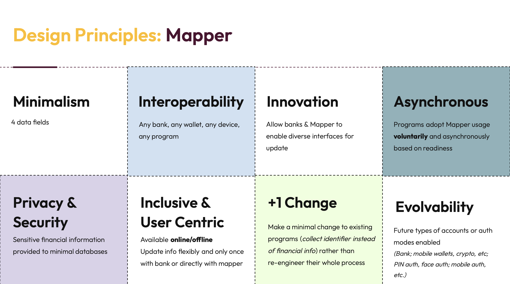
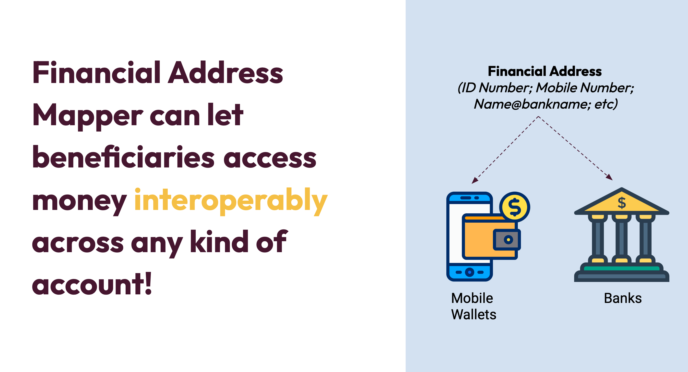
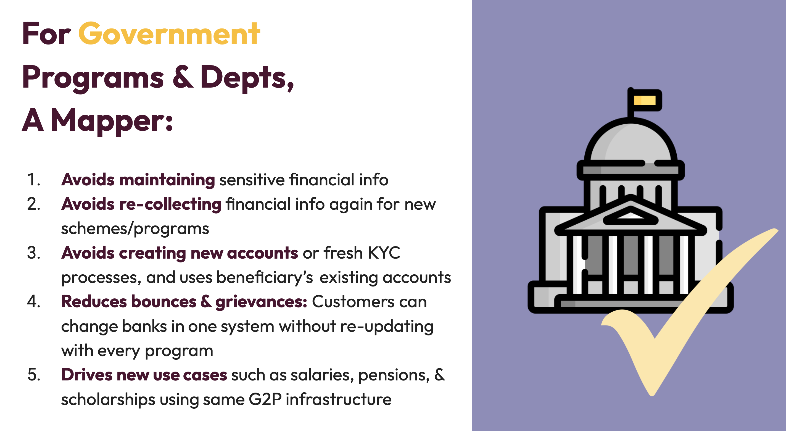
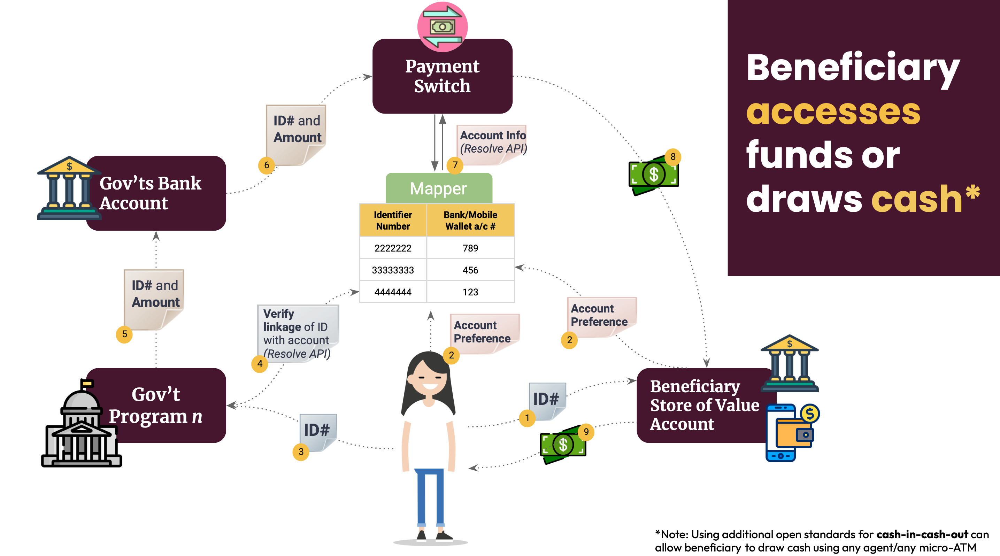

# Mapper Architecture

### Technology Architecture

#### Version 1.0

### 1. Introduction

Governments around the world transfer funds to individuals for a variety of purposes, including cash benefits programs, subsidies, salaries, scholarships, etc., which are often programs managed by various departments at federal/national, state/province-level, or district levels. However, a nation can craft a reusable and minimalist digital public infrastructure component that can power multiple departments to run various G2P programs in an efficient and high-agency manner. This DPI building block can allow any government department to direct a payment to a financial account using just an identity number from an existing ID system, without recollecting financial information or re-engineering its own payments infrastructure. This architecture document highlights a recommended technology architecture design to enable any government to build its own financial address mapper.

Any Government-to-Person (G2P) Payments program requires two key identifiers to complete the final stage of the benefit disbursement process -

1. Beneficiary Identifier
2. Target account information.

The G2P Connect Blueprint, among other functions, enables abstraction of the target account where the beneficiary receives digital payments as a store-of-value. The store-of-value can be a bank account, mobile wallet, voucher, prepaid card, digital currency, etc. A Financial Address Mapper is a simple key/value lookup registry designed to manage beneficiary ID to store-of-value account information as Digital Public Infrastructure. Such a mapper is one building block of the G2P Connect Blueprint.

## 2. Design Principles

Designing a Financial Address Mapper (FAM) should meet the core design principles outlined below. It is highly recommended that policy and technical architects take these principles into consideration when conceptualising and designing a Financial Address Mapper as a Digital Public Infrastructure.


<figure><figcaption></figcaption></figure>

### 2.1 Minimalism

Financial Address Mapper shall require minimal information about beneficiaries. In an ideal scenario, only four fields (Beneficiary ID, Name, Store-of-Value Address, Linking Status) are required to manage this registry. Where possible, the store-of-value address need not contain full bank account/mobile money account details; it can simply direct to the financial institution holding the store-of-value account.

FAM should avoid storing information about benefit schemes, scheme/beneficiary eligibility information, store-of-value account status, and similar data. Maintaining minimal data in the mapper shall keep external platform and system dependencies to a minimum.

### 2.2 Interoperability

Building a Financial Address Mapper that is compliant with G2P Connect mapper open specifications allows authorised systems and services to access the mapper. The architecture enables interoperability with any bank, any wallet, any device, and any social protection program. It is up to the policy makers to control which ecosystem participants are allowed to support or implement Mapper features. For example, the linking API can be implemented by Social Protection System, or Store-of-Value Account Provider, or directly by the Mapper Hosting Entity.

### 2.3 Innovation

Financial Address Mapper specifications use normalised addresses to represent ID and Financial Address. Normalised addressing enables innovation to easily accommodate new forms of foundational or functional IDs and Store-of-Value account types. Additionally, it allows ecosystem participants to innovate capabilities for easy access and updates to the mapper.

### 2.4 Asynchornous

Financial Address Mapper architecture and design unbundle the capabilities to encourage multiple players in the ecosystem to participate. Financial account information resides in Banking Platforms while other ecosystem participants interact with aliases. This enables loosely coupled interaction between ecosystem participants to encourage market-driven engagement.

Programs adopt mapper usage voluntarily based on readiness. This allows adoption to evolve asynchronously, incrementally rather than through a big bang approach.

### 2.5 Privacy & Security by Design

Financial Address Mapper specifications recommend managing minimal information with optimal ignorance to protect security and privacy of the beneficiary. The design ensures that only the required participants will have access to account details for final debit/credit actions on store-of-value accounts.

### 2.6 Inclusivity & User Centric

The Mapper should be designed to cover multiple types of store-of-value accounts that are inclusive across the population, including bank accounts, wallets, and mobile money accounts. Market innovations like purpose-limited vouchers, digital currencies etc., can easily be implemented using the G2P Connect proposed normative addressing.

Normative addressing represents store-of-value account information using aliases like:

```
a. token:12345@mosip
b. vid:12345@PhilID
c. account:12345@gtbank
d. account:12345@HDFC0000001.ifsc.npci
e. joeuser@gtbank
f. token:123456@sbi
g. 12345@DCash
```

Beneficiaries are central to any Financial Address Mapper design and rollout. Beneficiaries should have easy access to one or more entities to link and manage life cycle events of the mapper. Ecosystem players shall innovate to allow self-service/assisted use and online/offline access capabilities to reach diverse categories of users.

### 2.7 +1 Change

Financial Address Mapper is one of such components that can be easily unbundled from the existing platforms/systems/processes to build a new DPI component that opens up non-linear adoption with ease by embracing all aspects of DPI design principles.

### 2.8 Evolvability

The Financial Address Mapper is not restricted to one instance in a country. G2P Connect Mapper specifications enable multiple mappers to co-exist and easily interoperate with each other through interoperable open specifications. Registries can evolve independently across account types, authentication modes, sectors, and regulatory or governance aspects of a country.

## 3. Mapper Ecosystem

A typical Financial Address Mapper ecosystem players are:

### 3.1 Mapper Hosting Entity

Entity managing mapper registry and ecosystem partners. It is recommended that a neutral agency host the mapper.

Mapper Hosting Entity is responsible for:

1. Onboarding ecosystem partners and enabling access to mapper services through Open APIs, batch file interfaces, etc.
2. Design, Build, and Operate the Mapper registry.
3. Regulate and support other ecosystem partners through operational policies based on country-specific context.

### 3.2 Store of Value Provider

Store-of-value providers that have direct relationships with beneficiaries to provide banking and financial services.

Store-of-value providers perform the following activities:

1. Help interface beneficiaries to manage ID and store-of-value address with the entity hosting the mapper registry.
2. Authorise mapper linking requests by authenticating the right beneficiary.
3. Provide resolution of financial addresses to store-of-value account information for the final leg of digital payment credits using the underlying payment rails.
4. Transfer digital payments to store-of-value accounts.


<figure><figcaption></figcaption></figure>

### 3.3 Beneficiary

A person approved by the social protection system to receive benefits from one or more social protection schemes.

Beneficiaries receive the following benefits:

1. Manage store-of-value account information to receive all social benefits with one single entity and manage any life cycle changes only once.
2. Avoid having to share sensitive financial account information with multiple entities.

### 3.4 Social Protection System

System delivering social protection to beneficiaries.

Social protection systems enable the following capabilities: Help interface beneficiaries to manage ID to store-of-value address with the entity hosting the mapper registry. Create disbursement instructions to payment processing systems/rails to initiate benefit transfer using beneficiary ID.


<figure><figcaption></figcaption></figure>

## 4. Mapper Features

G2P Connect specifications recommend the following features be available to enable seamless integration between G2P payments processing ecosystem participants:

1. Link: Links a store-of-value address with a beneficiary ID. Entity enabling beneficiaries to link must ensure authentication and obtain required consents.
2. UnLink: Performs a soft or hard delete of the mapper registry entry.
3. Resolve: Given a foundational or functional ID, helps find the store-of-value normative address. Country-specific implementations may allow resolution to financial entity codes or end store-of-value account identifiers.
4. Status Check: Systems integration service endpoint for applications to communicate and reconcile in an automated manner. This capability enhances reliability and improves user experience capabilities.
5. Update: Update financial and other linked information. The entity enabling beneficiaries to update information must ensure authentication and obtain all required consents.

Below is an illustration of mapper implementation that enables beneficiaries to access funds or withdraw cash:


<figure><figcaption></figcaption></figure>

## 5. Recommended Best Practices

1. G2P Connect specification allows more than one mapper registry within a country. Having a registry within each ministry/agency or sector is perfectly fine as part of the initial rollout, and if there are enough synergies and trust built up, incremental consolidation will help both implementing agencies and beneficiaries.
2. Entities enabling linking (and life cycle management services) with the mapper registry MUST authenticate the owner of the account holder and the ID of the person being linked is indeed the same person. Specifications allow any existing authentication methods followed by the store-of-value service provider.
3. Obtaining consent is decentralised among the entities operating in the mapper registry ecosystem. This enables existing systems and business processes to adopt mapper registry as Digital Public Infrastructure. Migrating to Digital Consents shall help in population-scale operations with trust and enable automation.

## 6. Next Steps

Countries may use the checklist below to start the DPI journey:

1. The Ministry/Department operating one or more social benefit program(s) may consider a single Mapper Registry as a Digital Public Infrastructure building block Department. This agency may own and operate the Mapper Registry.
2. Work with ecosystem participants to identify policies and operational guidelines to use the existing services digitally.

## 7. Additional References

1. Financial Address Mapper - [Architecture Overview](https://docs.google.com/presentation/d/e/2PACX-1vRm6L3Bn2wvOA39-E78Y8K3vUPVy_eH9IqAQkk9teNEKqxbM-fslXoh2scf5-_MXLTWpkqg1R17ejd0/pub?start=false\&loop=false\&delayms=3000)
2. Financial Address Mapper - Policy Overview
3. Financial Address Mapper - [Mapper API Specification](https://g2p-connect.github.io/specs/dist/g2p-mapper.html)
